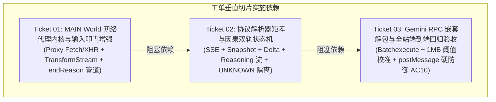

# API 旁路拦截与双轨架构实施全景 (Feature Overview)

- **特性代号**: `api-interception`
- **环级归属**: 第 4 环 (L4 Context & History)
- **父级规格**: [API 旁路拦截流式应答与轻量双轨架构技术规格说明书](../../specs/api-interception-spec.md)

## 1. 架构目标与全景依赖图

实现“前门叩门，后门收信”双轨架构，彻底消灭样式污染（Gemini 14,000 字 CSS 泄漏）、虚拟滚动截断（文心一言 2 字截断）、操作按钮遮蔽（ChatGPT 误抓）与模型切换夺焦（千问下拉框失焦）。

## 2. 切片分工与状态矩阵

| 工单编号 | 文件名 | 标题 | 类型 | 状态 | 依赖前置 |
| :--- | :--- | :--- | :---: | :---: | :--- |
| **01** | `01-network-proxy-kernel.md` | `MAIN` World 网络代理内核与输入叩门增强 | AFK | ready-for-agent | 无 (Frontier) |
| **02** | `02-protocol-parsers-and-state-machine.md` | 协议解析器矩阵与因果双轨状态机 | AFK | ready-for-agent | 依赖 Ticket 01 |
| **03** | `03-gemini-rpc-and-e2e-regression.md` | Gemini RPC 嵌套解包与全站端到端回归验收 | AFK | ready-for-agent | 依赖 Ticket 02 |
