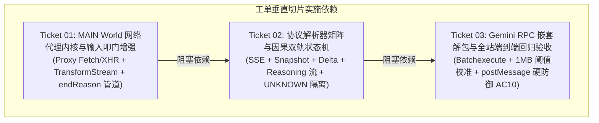

# API 旁路拦截与双轨架构实施全景 (Feature Overview)

- **特性代号**: `api-interception`
- **环级归属**: 第 4 环 (L4 Context & History)
- **父级规格**: [API 旁路拦截流式应答与轻量双轨架构技术规格说明书](../../specs/api-interception-spec.md)

## 1. 架构目标与全景依赖图

实现“前门叩门，后门收信”双轨架构，彻底消灭样式污染（Gemini 14,000 字 CSS 泄漏）、虚拟滚动截断（文心一言 2 字截断）、操作按钮遮蔽（ChatGPT 误抓）与模型切换夺焦（千问下拉框失焦）。

## 2. 切片分工与状态矩阵

| 工单编号 | 文件名 | 标题 | 类型 | 状态 | 依赖前置 |
| :--- | :--- | :--- | :---: | :---: | :--- |
| **01** | `01-network-proxy-kernel.md` | `MAIN` World 网络代理内核与输入叩门增强 | AFK | completed | 无 (Frontier) |
| **02** | `02-protocol-parsers-and-state-machine.md` | 协议解析器矩阵与因果双轨状态机 | AFK | completed | 依赖 Ticket 01 |
| **03** | `03-gemini-rpc-and-e2e-regression.md` | Gemini RPC 嵌套解包与全站端到端回归验收 | AFK | ready-for-agent | 依赖 Ticket 02 |

## 3. 跨工单核心契约 (Cross-Ticket Invariants)

1. **终端态与终止语义解耦**：下游 Reducer 状态判定**只认 `status` (`STREAMING` | `DONE` | `PARTIAL` | `ERROR`)**；`isDone: true` 仅指示底层物理管道已闭合，不得作为业务成功标志；
2. **`UNKNOWN` 流隔离隔离**：无法确定归属或非主会话的流标为 `UNKNOWN`，**只记录调试日志，绝不参与 GENERATION 互斥锁，绝不写入 `responseSnapshot` 或作为终审报告输入**；
3. **单帧上限可配置与渐进校准**：Ticket 01 定义可配置常量 `MAX_STREAM_FRAME_SIZE = 4 * 1024 * 1024` (保守 4MB)，防止前置阶段误杀大型报文；Ticket 03 进行实测压测后回填并锁定为“峰值 × 2”（阈值变更需同步更新 AC10a 的边界断言，改动为代码常量导出，保证测试与实现一致）；
4. **安全防御分层测试 (AC10 拆分)**：
   - **AC10a (Ticket 01 - 管道层单元测试)**：验证未知 `streamId` 的 `isDone: true` 拒收、终端态后增量 100% 丢弃、超限帧拦截、`sequence` 非单调拒收；
   - **AC10b (Ticket 03 - 端到端回归测试)**：验证网页伪造同源 `postMessage` 攻击下，Background 与 Side Panel 的 `ProviderRun` 状态 0 污染、0 异常推进。

